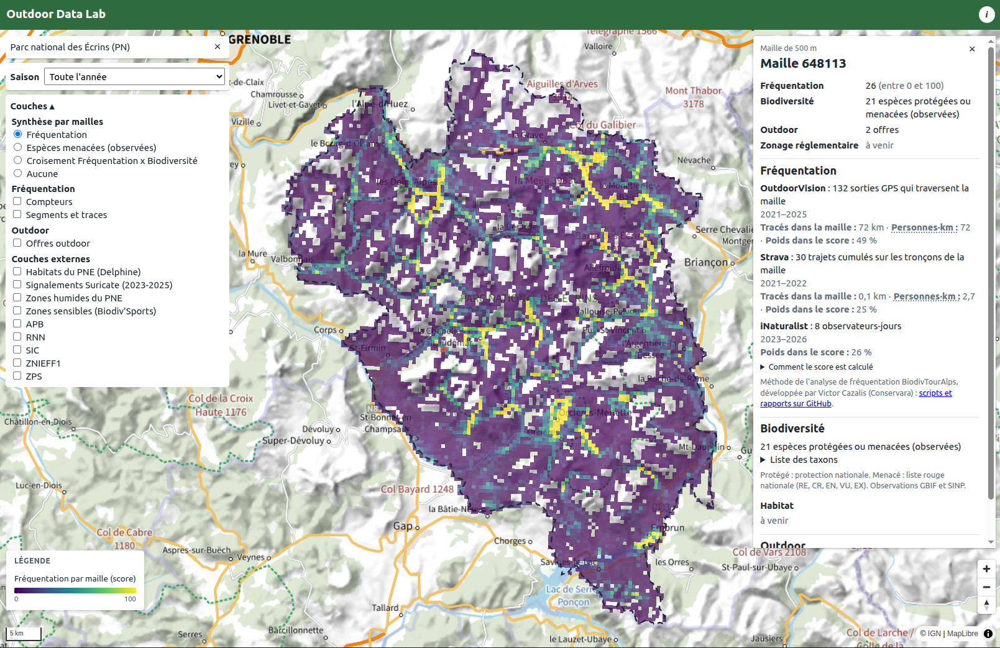
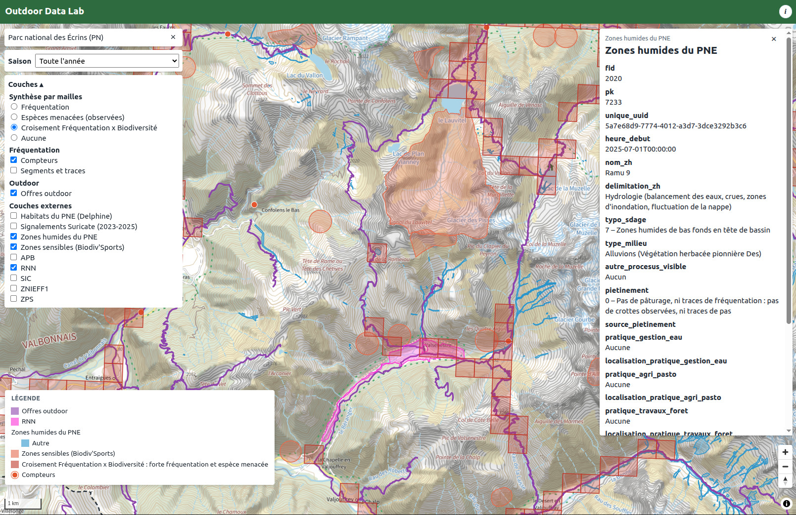

# Outdoor Data Lab

Outdoor Data Lab (ODL) is a database and a web application designed to aggregate, process, summarize, and explore visitor traffic and biodiversity data in natural areas. By centralizing, harmonizing, and analyzing diverse data sources, it offers a comprehensive initial snapshot of local environmental challenges.



- Presentation of the project and initial development workshop in November 2026: <https://data.ecrins-parcnational.fr/documents/technique/2026-11-19-restitution-workshop-ODL-presentation.pdf>
- Demonstration version: <https://odl.ecrins.net>

The data served are:

- **Visitor traffic data.** From outdoor traces, hike trails to automatic counter data (Outdoorvision, Strava, Eco-compteurs, Camera traps, iNaturalist observers...)
- **Biodiversity data** Observation of species, natural habitats (SINP, GeoNature, INPN, GBIF biodiversity observations

To do this, the stack is composed of:

- A database models based on exchange standards for naturalist and frequentation data (PostgreSQL database + PostGIS)
- An API allowing any data-visualisation library or app to easily retrieved data (Django + Django-RestFramework)
- An integrated visual interface (VueJS + MapLibre)

Main features:

- Import data from ODL collective applications: outdoor offerings from Geotrek, visitation data for Outdoorvision, biodiversity observations from SINP/INPN/GeoNature/GBIF)
- Multiple grid-based analysis scales, including 500m × 500m based on the national INPN grid
- Process visitor data to generate a grid-level attendance index, based on a simplified (and to improve) version of [Victor Cazalis analyzis method](https://github.com/PnEcrins/BTA-analyse-frequentation)
- Retrieve raw visitation or biodiversity data at the grid level
- Display external or local/territorial geospatial data (sensitive areas from Biodiv'sports, field reports from Suricate or any external GeoJSON API or file)
- Publish data via an interoperable API for web applications as well as GIS (Geographic Information System) and statistical software
- Load grid cells and data for a customizable geographic extent/bounding box



Full documentation available at
<https://outdoor-data-lab.github.io/2026-Workshop-Outdoor-Data-Lab/>.

## Requirements

- **Local repository clone** Keep a Git clone of this repository on the machine
  running the application and run the commands below from its root directory.
  Using a clone makes future updates straightforward with `git pull`.
- **Docker** This app was envisioned to be used with Docker. Follow the [official documentation](https://docs.docker.com/get-started/get-docker/) if Docker is not setup on your machine.

### Development requirements

- **Python** To setup the virtual environnement for Python, we recommend that you use `uv` ([Installation instructions](https://docs.astral.sh/uv/getting-started/installation/))
- **Node.js** If not installed, you can setup the recommended version of node using NVM and the `.nvmrc` file.
   ```sh
   cd frontend
   nvm install
   nvm use 
   ```
   If nvm is not installed on your computer, follow the [official documentation](https://nodejs.org/en/download) provided by Node.js

## Configuration

Docker Compose files are chained through the `COMPOSE_FILE` variable of the `.env` file:

- `docker-compose.yaml`: base stack (database, TaxHub init job, Django, frontend)
- `docker-compose-dev.yaml`: development overrides (dev servers, exposed ports, watch, debug)
- `docker-compose-prod.yaml`: production overrides (Gunicorn, nginx, Traefik with HTTPS)

Create your `.env` from the sample and fill in the values:

```sh
cp .env.sample .env
```

## Get started

To run the dev stack (`COMPOSE_FILE=docker-compose.yaml:docker-compose-dev.yaml` in `.env`),

```sh
docker compose up -d
```

> [!NOTE]
> An easy way of listening to changes in requirements and DockerFile is to use the `watch` target
> ```sh
> docker compose watch
> ```

To stop the stack,

```sh
docker compose down
```

To stop the stack and erase the database (`db-data` volume)

```sh
docker compose down -v
```

## Deploy to production

From the repository clone on the server, with Docker installed, ports 80 and 443
open and the domain's DNS pointing to it:

```sh
cp .env.sample .env
```

In `.env`, set `COMPOSE_FILE=docker-compose.yaml:docker-compose-prod.yaml`, `DOMAIN`, `ACME_EMAIL` and strong secrets (`POSTGRES_PASSWORD`, `DJANGO_SECRET_KEY`, `TAXHUB_SECRET_KEY`). Then:

```sh
docker compose up -d --build
```

Traefik gets a Let's Encrypt certificate for `DOMAIN` and redirects HTTP to HTTPS. `/api`, `/admin` and `/static` go to Django, everything else to the frontend. Django migrations run when the `web` container starts, after the TaxHub init job has finished.

Create an admin account:

```sh
docker compose exec web python backend/manage.py createsuperuser
```

## Documentation

The full documentation is published at
<https://outdoor-data-lab.github.io/2026-Workshop-Outdoor-Data-Lab/>.

To preview it locally with live reload:

```sh
uv run --group docs mkdocs serve
```

The source includes guides for [importing data](docs/imports.md), configuring
[external layers](docs/external-layers.md), and changing the
[layer order](docs/layer-order.md).

## Load demonstration traffic data

Start the development stack, then load the sample traffic data with the Django management command:

```sh
docker compose exec web python backend/manage.py load_traffic_demo
```

The command runs `backend/workshop2026/processing/insert_traffic_data.sql`. The script creates five synthetic counters or segments in the first three 1 km grid cells of ref_geo, with counts on the 5th, 15th and 25th of January–March 2023 (and 2024 for one counter). It is safe to rerun: only rows with the script's `demo_m1_*` external IDs are replaced. These records are sample data, not real observations.

Counts and scores per 1 km grid cell are computed on the fly from the measures. The cells of each counting object are kept in `traffic.counting_object_areas` by a database trigger. If ref_geo was loaded or reloaded after the counting objects, rebuild that table:

```sh
docker compose exec web python backend/manage.py sync_counting_object_areas
```

The grid is the ref_geo area type given by `DEFAULT_GRID_AREA_TYPE` in `.env` (default `M0.5`, the 500 m grid added by traffic migration 0008; `M1`: 1 km), among the grids of `AREA_TYPES` (default `M1,M0.5`). After changing it, rerun the command above (or pass `--area-type M0.5` once) to rebuild `traffic.counting_object_areas` for the new grid.
