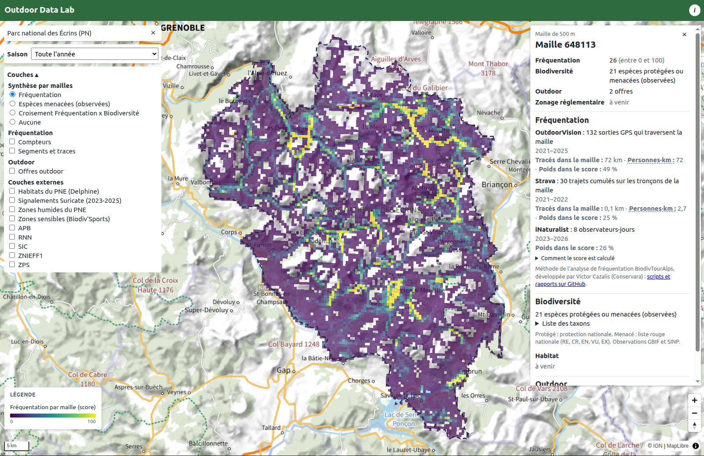

# CHANGELOG

## 0.1.0 (2026-11-24)

### 🚀 Nouveautés

* Première version installable et fonctionnelle du logiciel du collectif Outdoor Data Lab.
* Import de données depuis l'interface d'administration, à partir de fichiers CSV, GPKG ou ZIP provenant de : 
  * Outdoorvision
  * Strava
  * Compteurs (Eco-compteurs, pièges photo...)
  * iNaturalist
  * GBIF
  * GeoNature
  * SINP
  * INPN
  * Geotrek
  * Apidae
  * DATATourisme
* Traitement automatique des données de fréquentation et synthèse par maille sur la base d'une version simplifiée (et améliorable) de la [méthode statistique de Victor Cazalis](https://github.com/PnEcrins/BTA-analyse-frequentation)
* Synthèse par maille des observations taxons de biodiversité protégés ou menacés
* API documentée permettant d'accéder à l'ensemble des données brutes et traitées et de les intersecter avec des géométries
* Interface cartographique de consultation de l'ensemble de ces données, avec la possibilité de l'enrichir de données externes 
* Documentation de l'installation et de l'import de données

### 💻 Version développée par : 

* LPO France​ et AuRA (@lpofredc)
* Natural Solutions (@IdrissaD)​
* PatriNat (MNHN-OFB-CNRS-IRD) (@christophe-ramet, @Pierre-Narcisi, @VincentCauchois)
* Parc national des Cévennes (@amandine-sahl)​
* Parc national des Écrins (@camille-monchicourt, @jacquesfize, Pierrick Navizet, @raphaeldoisy, @TheoLechemia)
* PRNTESN - CREPS AuRA Vallon Pont d’Arc · Voiron · Lyon (Adrien Lambert, Patrick Gilles)
* Réserves naturelles de France (@aschlegle)
